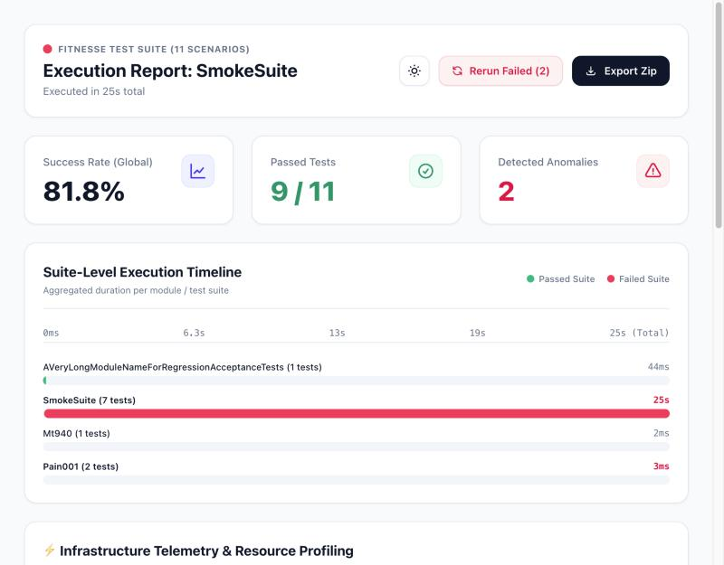
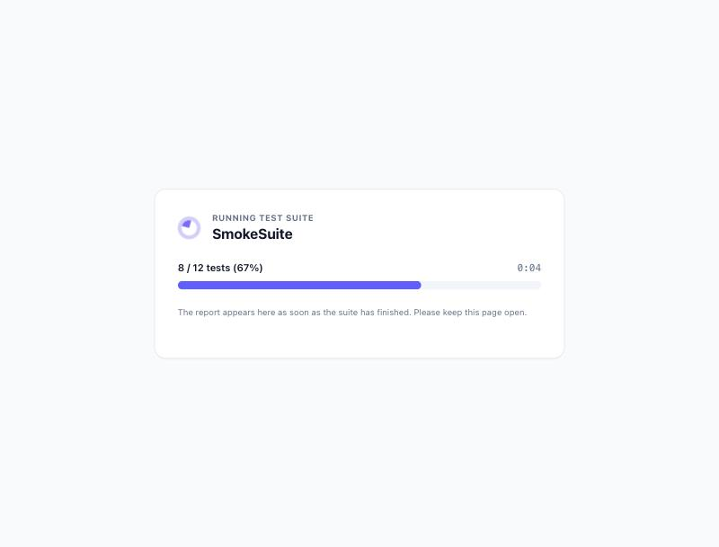
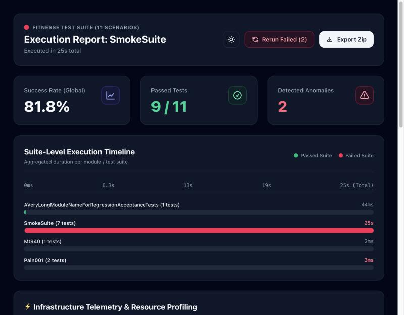
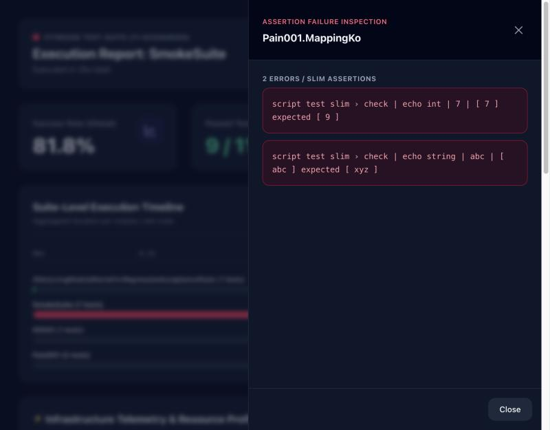
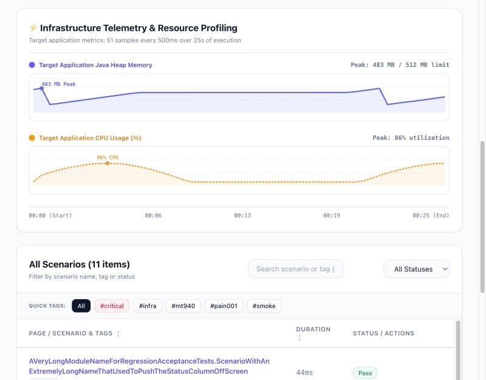
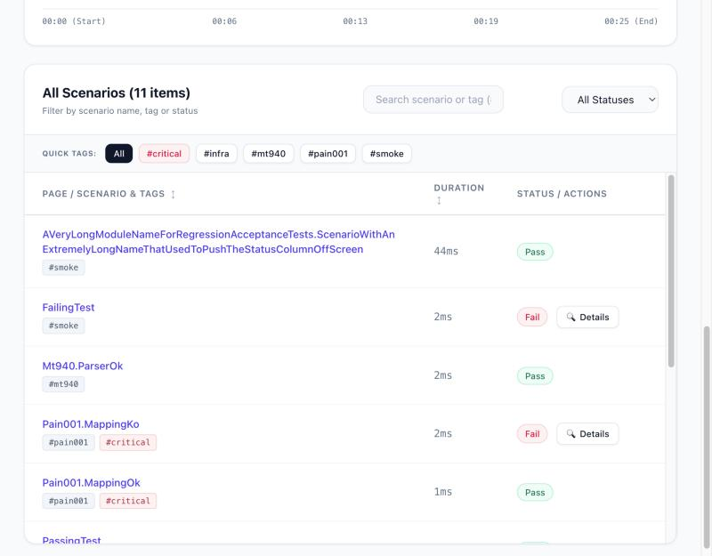

# FitNesse Execution Report

[](https://central.sonatype.com/artifact/io.github.tortaje/fitnesse-modern-report)

A [FitNesse](https://fitnesse.org) plugin that turns a suite run into a modern, self-contained HTML dashboard: success rate, suite timeline, filterable scenario table, focused error details, live Java heap / CPU charts of the application under test, one-click rerun of failures and a portable ZIP export.

It runs inside the FitNesse JVM, needs no framework and no internet access, and is opened with a single URL:

```
http://localhost:8089/?responder=ExecutionReport&page=MyProject.MySuite
```



## Features

- **Live progress**: the page opens immediately with a progress bar (`8 / 12 tests (67%)`, elapsed time) while the suite is running, instead of a browser that spins on a blank page. The report replaces it when the suite is finished.
- **Executive summary**: success rate, passed tests and detected anomalies at a glance.
- **Suite-level timeline**: aggregated duration per sub-suite, failed suites in red.
- **Infrastructure telemetry**: the plugin polls the application under test *while the suite runs* and charts Java heap and CPU, with the peak annotated. Supports Spring Boot Actuator and Quarkus / Micrometer (Prometheus) endpoints.
- **Scenario table**: search by name or tag, filter by status (`Pass` / `Fail` / `Error`) or by tag, sort by name or duration. Each name links to the FitNesse **execution page** of that run (not the wiki source).
- **Focused error panel**: instead of the whole wiki page, only the failing table rows are shown, one card per error.
- **Rerun Failed**: re-executes only the failed tests in the background and merges the new results into the report. Tests that already passed are left untouched.
- **Export Zip**: a static copy of the report (`index.html`, `report.json`) plus the FitNesse execution page of every test in `details/`, ready to attach to a build or send by mail.
- **Light and dark themes**, remembered per browser.
- **Self-contained**: Tailwind CSS and JSZip are embedded in the plugin jar. The report makes no request to a CDN.
- **Secured like the rest of FitNesse**: if you run FitNesse with authentication, so does the report.

| Live progress while the suite runs | Overview (dark) |
|---|---|
|  |  |







## How it works

1. FitNesse routes `?responder=ExecutionReport` to the plugin's responder, which answers at once with the page and its progress bar and keeps the response open.
2. The responder calls back FitNesse on `127.0.0.1` (`/<page>?suite&format=xml&includehtml`), which **runs the suite**. While this call is in progress:
   - the plugin asks FitNesse for the list of tests (`?partition&format=tsv`, without running them) and, every 500 ms, counts those that already have a new entry in the FitNesse test history. FitNesse only sends its XML results once the whole suite is done, but it writes a history entry as soon as each test completes. The counts are pushed to the open page;
   - a background sampler polls the metrics endpoint of your application, if configured.
3. When the suite has finished, the results are parsed on the server, reduced to JSON (names, status, tags, durations, failing rows) and sent as the last part of the same response. The page replaces the progress bar with the report, rendered by plain JavaScript in the browser.

Consequently **every display of the report with a `page` parameter runs the suite**, and the page must stay open until it is finished: reloading it starts a new run. Opening the URL without `page` shows an empty report.

## Requirements

- Java 17 or later (the plugin is compiled with `release 17`).
- FitNesse 20260313 (built and tested against it; the plugin also ran on 20251025, and only uses stable plugin APIs, so other recent versions should work).
- Maven to build it (built here with Maven 3.10).

## Build

```bash
mvn package
```

The plugin is `target/fitnesse-modern-report-<version>.jar`. To use it from other Maven projects, install it in your local repository (or deploy it to your company repository):

```bash
mvn install
```

## Installation

The plugin registers itself through `META-INF/services/fitnesse.plugins.PluginFeatureFactory`: **no entry in `plugins.properties` is required**. It only has to be on the classpath of the JVM running FitNesse.

### Standalone FitNesse

FitNesse loads every jar found in the `plugins/` directory next to `FitNesseRoot`.

```bash
mkdir -p my-fitnesse/plugins && cd my-fitnesse
curl -L -o fitnesse-standalone.jar \
  https://repo1.maven.org/maven2/org/fitnesse/fitnesse/20260313/fitnesse-20260313-standalone.jar
cp /path/to/fitnesse-modern-report-<version>.jar plugins/

java -jar fitnesse-standalone.jar -p 8089 -d "$PWD"
```

Open `http://localhost:8089/?responder=ExecutionReport&page=<YourSuite>`.

### Existing project with embedded FitNesse (maven-antrun-plugin)

If your project starts FitNesse (with your own fixtures) from an Ant `java` task, add the plugin as a dependency and make sure it is on the classpath of the forked JVM.

```xml
<dependencies>
  <dependency>
    <groupId>org.fitnesse</groupId>
    <artifactId>fitnesse</artifactId>
    <version>20260313</version>
    <scope>test</scope>
  </dependency>
  <dependency>
    <groupId>io.github.tortaje</groupId>
    <artifactId>fitnesse-modern-report</artifactId>
    <version>1.0.0</version>
    <scope>test</scope>
  </dependency>
</dependencies>

<build>
  <plugins>
    <plugin>
      <groupId>org.apache.maven.plugins</groupId>
      <artifactId>maven-antrun-plugin</artifactId>
      <version>3.1.0</version>
      <executions>
        <execution>
          <id>fitnesse</id>
          <goals><goal>run</goal></goals>
          <configuration>
            <target>
              <java classname="fitnesseMain.FitNesseMain" fork="true" classpathref="maven.test.classpath">
                <arg line="-p 8089 -d ${project.basedir}/fitnesse"/>
                <!-- optional: infrastructure metrics, see Configuration -->
                <sysproperty key="report.metrics.url" value="http://localhost:8080/actuator/metrics"/>
                <sysproperty key="report.metrics.interval" value="500"/>
              </java>
            </target>
          </configuration>
        </execution>
      </executions>
    </plugin>
  </plugins>
</build>
```

Notes:

- `fork="true"` is required: FitNesse discovers the plugin through the system class loader of the JVM it runs in.
- If the classpath comes from the dependencies of the antrun plugin itself, declare the plugin jar in the antrun plugin's `<dependencies>` and use `classpathref="maven.plugin.classpath"`.
- Alternatively, copy the jar into `<fitnesse root dir>/plugins/` (for instance with `maven-dependency-plugin:copy`), exactly like the standalone case.
- Your own fixtures are unaffected: the plugin only adds a responder.

## Usage

| URL | Result |
|---|---|
| `/?responder=ExecutionReport&page=Suite.Path` | Runs the suite and shows the report |
| `/?responder=ExecutionReport` | Empty report (no suite is run) |
| `/?responder=ExecutionReport&format=json&page=Suite.Path&relativeTo=Suite` | Same results as JSON (used internally by *Rerun Failed*) |

If FitNesse cannot be called back or returns invalid results, the progress screen turns into an error screen with the cause and a **Retry** link. The response is already open at that point, so its HTTP status stays `200`; the error is part of the page. (The `format=json` endpoint answers `502` with a JSON error, and `400` when `page` is missing.)

## Configuration

Infrastructure metrics are optional and disabled until `report.metrics.url` is set. The keys can be given in any of the places FitNesse reads variables from (in this order): environment variables, JVM system properties (`-Dreport.metrics.url=…`), then `plugins.properties` in the directory passed to `-d`.

```properties
report.metrics.url=http://localhost:8080/actuator/metrics
report.metrics.format=actuator
report.metrics.interval=500
```

| Key | Description | Default |
|---|---|---|
| `report.metrics.url` | Base URL of the application under test. Without it, the telemetry section shows *N/A*. | *(disabled)* |
| `report.metrics.format` | `actuator` (Spring Boot Actuator) or `prometheus` (Quarkus / Micrometer text format). | `actuator` |
| `report.metrics.interval` | Polling period in milliseconds, minimum `100`. | `1000` |

FitNesse reads these values at startup: restart it after changing them.

### Spring Boot (`format=actuator`)

Expose the `metrics` endpoint and point the plugin at its base URL. The plugin reads `jvm.memory.used` and `jvm.memory.max` (tag `area:heap`) and `process.cpu.usage`:

```properties
# application.properties of the application under test
management.endpoints.web.exposure.include=health,metrics
```

```properties
# plugins.properties of FitNesse
report.metrics.url=http://localhost:8080/actuator/metrics
```

### Quarkus (`format=prometheus`)

Add `quarkus-micrometer-registry-prometheus` to the application under test, then:

```properties
report.metrics.url=http://localhost:8080/q/metrics
report.metrics.format=prometheus
```

The plugin reads `jvm_memory_used_bytes`, `jvm_memory_max_bytes` (heap) and `process_cpu_usage`.

### Good to know

- Charts need a suite that lasts a few seconds: the sampler runs for as long as the suite runs.
- If the metrics endpoint cannot be reached, the report is still produced and the telemetry section explains why.
- Metrics are collected for the full run, not for *Rerun Failed*.
- The URL is only called from the FitNesse server; it is never exposed to the browser.

### Try it with the sample application

`sample-target-app/SampleTargetApp.java` is a dependency-free stand-in for the application under test. It exposes real JVM heap and CPU figures in both styles and generates a CPU / memory wave:

```bash
java -Xmx512m sample-target-app/SampleTargetApp.java 8080
#   Spring Boot style  http://localhost:8080/actuator/metrics
#   Quarkus style      http://localhost:8080/q/metrics   (report.metrics.format=prometheus)
```

## Security

- The responder is protected by FitNesse's authenticator. With `-a user:password` (or a password file) an anonymous request gets `401`; without authentication FitNesse is open and so is the report. The caller's credentials are forwarded on the call-back that runs the suite.
- Test output is escaped before it is displayed, and data embedded in the page cannot close its `<script>` element.
- XML results are parsed with DOCTYPE declarations disabled (no external entities).
- Pages added to the exported ZIP come from the wiki, so they are made inert: scripts, frames, `on*` handlers and `javascript:` links are removed and a Content-Security-Policy forbids scripts.
- No third-party code is loaded at run time; see [`THIRD-PARTY-NOTICES.md`](src/main/resources/vendor/THIRD-PARTY-NOTICES.md) for the embedded libraries (Tailwind CSS 4.3.3 and JSZip 3.10.1, both used under the MIT licence).

## Limitations

- Each display of a report runs the suite again, and reloading the page during a run starts another one.
- Progress relies on the FitNesse test history, which is on by default. If it is disabled the bar stays at its starting point (the elapsed time still runs) and the report appears when the suite is done.
- A reverse proxy that buffers responses (nginx for instance) delays the progress display; turn buffering off for this URL if you put one in front of FitNesse.
- The HTTP status of the page is always `200`; callers that script the URL must look at the content for errors.
- *Rerun Failed* relies on the `RerunLastFailures_<suite>` page that FitNesse creates after a suite run; it is disabled when nothing failed. Merged results exist only in the open page: reloading it runs the whole suite again.
- *Export Zip* is generated in the browser, from the page that is open on the FitNesse server.
- Heap and CPU come from the application under test only if it exposes them as described above.

## Development

```bash
mvn test        # unit tests and an integration test that starts an embedded FitNesse
```

| Path | Role |
|---|---|
| `ExecutionReportPlugin` | Registers the responder (discovered through `ServiceLoader`) |
| `ExecutionReportResponder` | Handles `?responder=ExecutionReport`; streams the page, runs the suite call-back, samples metrics |
| `RunProgress`, `ProgressPoller` | Test list from FitNesse and live count of completed tests from its history; pushes progress to the open page |
| `ResultFetcher` | Minimal HTTP client for FitNesse's chunked responses |
| `ResultParser`, `ErrorExtractor` | Turn FitNesse XML into scenarios and keep only the failing table rows |
| `MetricsConfig`, `MetricsParser`, `MetricsSampler` | Configuration, Actuator / Prometheus parsing and background polling |
| `src/main/resources/dashboard.html` | The report page (HTML, CSS and plain JavaScript) |
| `src/main/resources/vendor/` | Embedded Tailwind CSS and JSZip, with licences and checksums |
| `sample-target-app/` | Demo application exposing heap and CPU |
| `docs/manual-test.md` | Step-by-step manual test procedure |

## License

This project is licensed under the [Apache License, Version 2.0](LICENSE).

It embeds Tailwind CSS and JSZip (both used under the MIT licence); their licences and checksums are listed in [`THIRD-PARTY-NOTICES.md`](src/main/resources/vendor/THIRD-PARTY-NOTICES.md). FitNesse itself is not bundled: it is a `provided` dependency and keeps its own licence.
